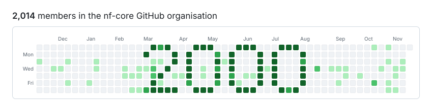
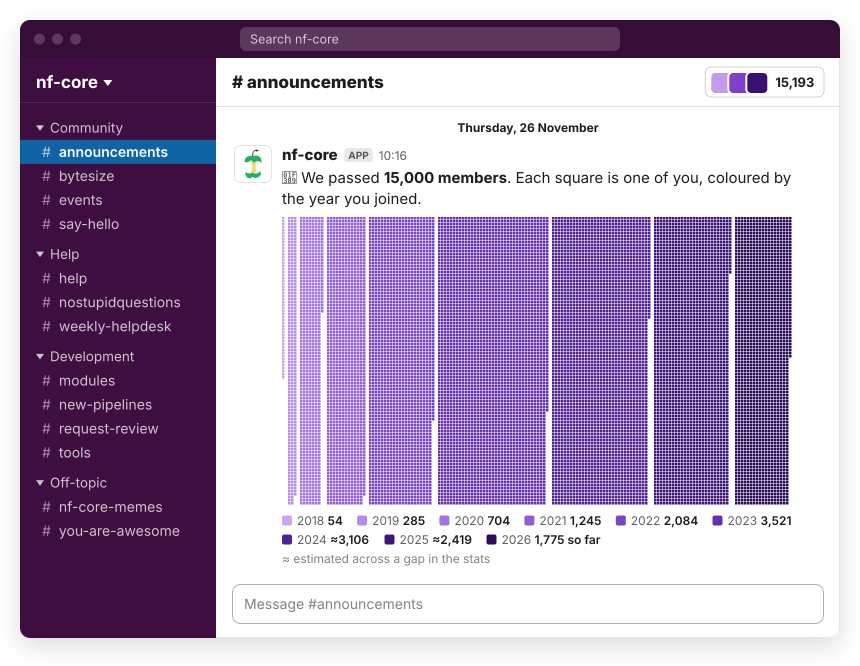
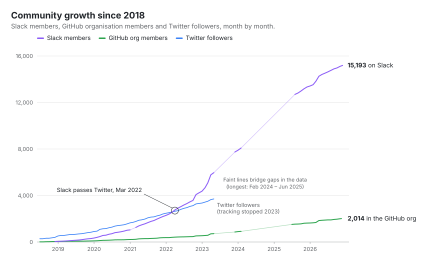
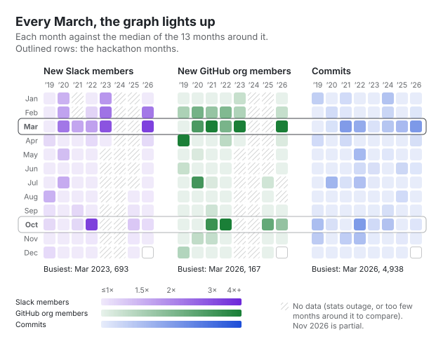
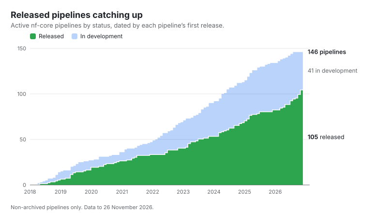
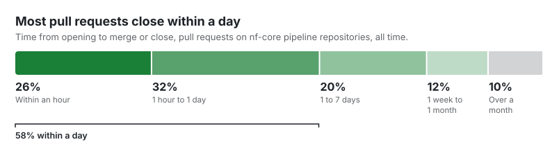

import NewsletterSignup from "@components/newsletter/NewsletterSignup.astro";

On 7 October the nf-core Slack workspace passed 15,000 members. Four weeks later, on 3 November, the nf-core GitHub organisation passed 2,000.

Thank you, all of you. Every question asked on Slack, every review and every first pull request is part of those numbers.

A round number is a good excuse to look at the data behind it. Everything in this post comes from the [nf-core stats pages](https://nf-core-stats.netlify.app/), which pull from the GitHub and Slack APIs every day ([source on GitHub](https://github.com/nf-core/stats)).

## 15,000 on Slack

Slack is where the community talks. Some people join with a question about running a pipeline, others after their first module pull request. Plenty stay to help others.

Exactly six years ago, the workspace passed 1,000 members, and it has grown fifteen-fold since. This year, around 160 new people have joined each month.

Slack counts someone as active if they've used it in the past 14 days. Right now that's 1,016 people. The record is 2,196, on 21 March this year, the week after the hackathon.

## Still climbing

Slack reached 1,000 members in November 2020, around two years after the community was started. The latest 1k, from 14,000 to 15,000, only took seven months.

The GitHub organisation is speeding up too. So far in 2026, 378 people have joined, more than one a day.

## The March effect

Each square below compares one month with the months around it, so the long-term growth drops out and only the seasonal pattern is left. In most years, in all three panels, the March row lights up.

March is the big distributed nf-core hackathon, and it keeps growing (maybe something to do with our community members' [musical flair](/blog/2024/hackathon-march-2024)?). In 2025, over 1,000 people registered, at 44 local sites in 27 countries and online.

Many of the people who take part are already on Slack and in the GitHub organisation, so the March spikes only count newcomers on top of that crowd. On the first day of this year's hackathon (11 to 13 March), 180 new people joined Slack. Over the first two days, 127 joined the GitHub organisation (48, then 79), taking it from 1,700 to 1,800 members. March 2026 ended as the busiest month we have data for, both for new GitHub members (167) and for commits (4,938). October has a smaller bump of its own from the autumn hackathon at the Nextflow Summit in Barcelona.

## From chat to commits

The stats site counts 201,239 commits across nf-core repositories, from at least 1,238 different people. That second number is a floor: GitHub's statistics API only reports the top 100 contributors for each repository.

Beyond the top 100 contributors, more than 1,100 people have made around 34,000 commits between them: one-line fixes, first release pull requests and everything in between.

Not every committer is a person. `nf-core-bot` is fifth on the leaderboard with 9,351 commits, and Renovate and GitHub Actions both make the top 100. Since June 2025 the `claude` account has made 3,215 commits, which puts it 13th. As Maxime put it in our [statement on AI](/blog/2026/statement-on-ai), if a pigeon were to commit good code, he would accept it.

## More pipelines, in more fields

nf-core has 146 active pipelines, and more than 100 of them have a stable release. We aim for one pipeline per type of analysis, so the common genomics workflows are well covered by now and new pipelines increasingly mean new techniques and fields. Recent arrivals process satellite imagery of rangelands ([`rangeland`](/rangeland)), light-sheet microscopy ([`lsmquant`](/lsmquant)) and whole-slide tissue images ([`mcmicro`](/mcmicro)), and track malaria drug-resistance markers ([`plasmodiumdrugres`](/plasmodiumdrugres)).

Just as striking is how many pipelines are graduating from development. 23 have had their first stable release so far this year, more than in any year before.

With so much happening, it's easy to miss things. The new [nf-core newsletter](/newsletter) helps: once a month it rounds up pipeline releases, new pipeline proposals and blog posts like this one, and sends them to your inbox.

<NewsletterSignup compact={true} />

## Reviews are quick

All of that code gets reviewed by someone else in the community. Since 2024 that has meant around 8,000 pull requests a year across nf-core repositories.

On pipeline repositories, a quarter of pull requests are merged or closed within an hour, and 58% within a day. Some are one-line fixes. Others are major pipeline updates that need proper review, so a long tail is expected.

## More than code

For a lot of people, the friendships and the sense of community are why they join, and why they stay. In our [2025 community survey](/blog/2025/survey-results-2025), the thing people liked most about nf-core was the community itself: welcoming, friendly and helpful. Several of the default Slack channels have nothing to do with code, from `#say-hello` to `#you-are-awesome` and `#nf-core-memes`.

Eight years of that has built up its own folklore, collected on the [nf-lore page](/lore/). It includes the sock stickers hidden around every in-person hackathon, the planking photos, the quiz question on markdown link syntax that everyone gets wrong, and a coaster carried through the wilderness of Sarek National Park. Then there are the [stickers](/stickers/): 75 hex designs so far, for pipelines, hackathons, Nextflow Summits, champions and mentorships.

## Come and join us

If you haven't joined yet, now's a good time:

- Join the [nf-core Slack](/join/slack)
- Ask for an invite to the GitHub organisation in [`#github-invitations`](https://nfcore.slack.com/channels/github-invitations) on Slack
- Sign up for the [newsletter](/newsletter), which passed 100 subscribers this week
- Explore the numbers yourself on [nf-core stats](https://nf-core-stats.netlify.app/)

See you in Slack or GitHub ;)
