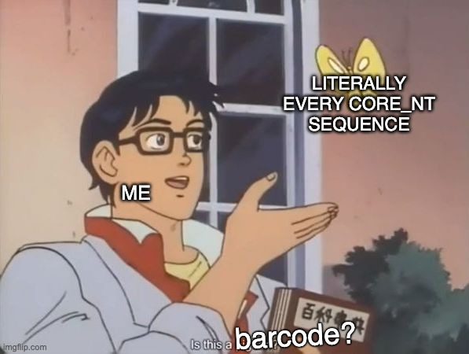

## Goal

Port an existing bash pipeline to Nextflow, write documentation.

## Description

BarcodeMiner is a draft pipeline that leverages Dicey to mine the entire NIH Core_nt database of sequences for sequences that can theoretically be amplified by a given pair of primers. It allows building custom reference taxonomy database for amplicon-based sequencing experiments, but also identifying potential non-target organisms that a primer pair could amplify. It was first used in [Poirier et al, 2026](https://www.sciencedirect.com/science/article/pii/S0048969726002846) to build a taxonomic reference database for the trnL amplicon and is currently being used in a manuscript to profile arbuscular mycorrhizal fungal communities using the AML2-WANDA primer pair.

## Tasks

- Build a dicey module
- Write subworkflows: database index builder, core algorithm, NCBI taxonomy cleaner
- Docs
- More on the way! 
