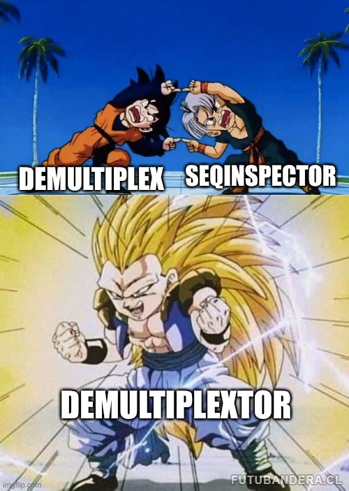

## Goal

Connect [nf-core/demultiplex](https://nf-co.re/demultiplex) and [nf-core/seqinspector](https://nf-co.re/seqinspector), from raw sequencing runs to QC reports.

## Tasks

- Use demultiplex outputs as seqinspector input.
- Run QC steps where they belong, and reduce code duplication.
- Fix open issues and improve docs in both pipelines.

:::note
Keep an eye on this page for more updates.
:::
